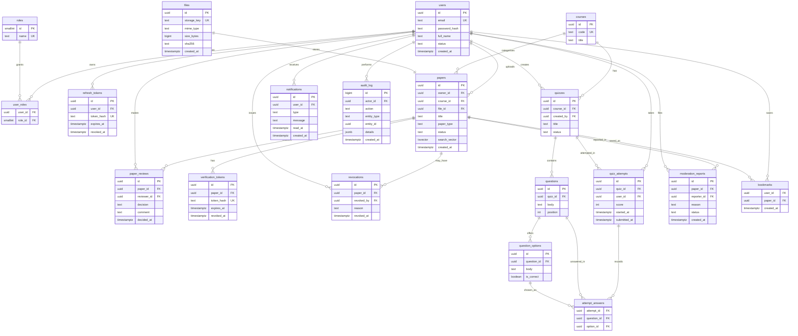

# Entity Inventory and ERD

**Role:** DB / Database Engineer
**Owner:** madisonjuah1-hue
**Deliverable:** Entity inventory and ERD
**Due:** 27 October 2026
**Status:** Draft for team review (not confirmed until the team agrees)

Source: `docs/planning/TEAM_AND_TASK_PLAN.md` and the concept paper's suggested modules (Identity, Papers, Verification, Library, Search, Moderation, Notifications, quizzes). Database: PostgreSQL, with file binaries kept in file storage and only metadata in the database.

Labels: **M** = mandatory for MVP, **O** = optional or deferred.

---

## 1. Entity inventory

| # | Entity | Module | M/O | Purpose |
|---|--------|--------|-----|---------|
| 1 | `users` | Identity | M | Account: email, password hash, status |
| 2 | `roles` | Identity | M | Student, Lecturer, Moderator, Admin |
| 3 | `user_roles` | Identity | M | Many-to-many link between users and roles |
| 4 | `refresh_tokens` | Identity | M | Hashed refresh tokens, expiry and revocation |
| 5 | `courses` | Library | M | Course code and title used to organise papers |
| 6 | `files` | Papers | M | File metadata (storage key, mime, size, checksum) |
| 7 | `papers` | Papers | M | Uploaded paper or study material: owner, course, type, status |
| 8 | `paper_reviews` | Verification | M | Lecturer/moderator approval decisions on a paper |
| 9 | `verification_tokens` | Verification | M | Hashed QR token for public verification, with expiry |
| 10 | `revocations` | Verification | M | Record of a paper or token being revoked, with reason |
| 11 | `quizzes` | Quizzes | M | Multiple-choice quiz tied to a course |
| 12 | `questions` | Quizzes | M | Question text, belonging to a quiz |
| 13 | `question_options` | Quizzes | M | Answer options, with one flagged correct |
| 14 | `quiz_attempts` | Quizzes | M | A student's attempt and score |
| 15 | `attempt_answers` | Quizzes | M | Option chosen per question in an attempt |
| 16 | `moderation_reports` | Moderation | O | User reports against a paper |
| 17 | `notifications` | Notifications | O | In-app notifications (approval, revocation, etc.) |
| 18 | `audit_log` | Cross-cutting | M | Who did what and when (approvals, revocations, role changes) |
| 19 | `bookmarks` | Library | O | Saved papers per user |

Search needs no separate table for the MVP: use PostgreSQL full-text search (`tsvector`) on `papers`.

---

## 2. ERD

---

## 3. Key constraints

- `users.email` is unique and stored lowercase.
- `user_roles` has the composite primary key `(user_id, role_id)`.
- `papers.status` is one of `pending`, `approved`, `rejected`, `revoked`.
- `paper_reviews.decision` is one of `approved`, `rejected`.
- `attempt_answers` has the composite primary key `(attempt_id, question_id)`.
- `bookmarks` has the composite primary key `(user_id, paper_id)`.
- Foreign keys use `ON DELETE RESTRICT` for papers and users. Child rows such as options, answers and tokens use `ON DELETE CASCADE`.
- Tokens (refresh and verification) are stored only as hashes, never in plain text.

## 4. Index plan

| Table | Index | Reason |
|-------|-------|--------|
| `papers` | GIN on `search_vector` | Full-text search |
| `papers` | `(course_id, status)` | Library browsing by course |
| `papers` | `(owner_id)` | "My uploads" |
| `paper_reviews` | `(paper_id)` | Approval history |
| `verification_tokens` | unique `(token_hash)` | Fast public QR lookup |
| `refresh_tokens` | `(user_id)` and unique `(token_hash)` | Session lookup and revocation |
| `quiz_attempts` | `(user_id, quiz_id)` | Attempt history |
| `notifications` | `(user_id, read_at)` | Unread count |
| `audit_log` | `(entity_type, entity_id)` and `(created_at)` | Investigation and review |

## 5. Migration order

1. `roles`, `users`, `user_roles`, `refresh_tokens`
2. `courses`, `files`, `papers` (and the search index)
3. `paper_reviews`, `verification_tokens`, `revocations`
4. `quizzes`, `questions`, `question_options`, `quiz_attempts`, `attempt_answers`
5. `audit_log`
6. Optional: `moderation_reports`, `notifications`, `bookmarks`
7. Seed data: the four roles

## 6. Backup design (proposal for the team to confirm)

- Nightly `pg_dump` with a retention window (for example 7 daily and 4 weekly copies), stored off the database host.
- Back up file storage on the same schedule.
- Run a restore test periodically so the backups are known to work.
- Hosting and exact retention are for the Architecture and OPS roles to decide.

## 7. Open questions for the team

- Is `moderation_reports` in the MVP or deferred?
- Are notifications in-app only, or also email?
- Do papers need version history (replacing a file after approval)?
- Should a paper's QR token be regenerated after each re-approval?

---

## Evidence for the work log

- Issue/PR link: _paste here after creating the Issue/PR_
- Status: Draft submitted for review
