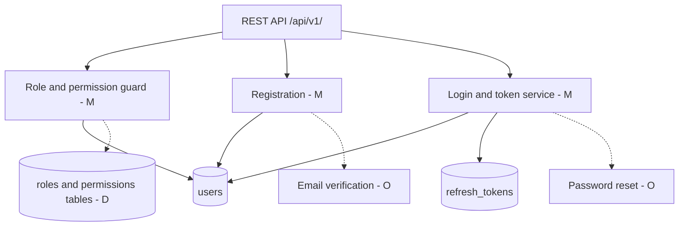

# Identity Module Draft: Registration, Login, Roles and Permissions

*Backend Identity (ID) module. Draft for team review. Items marked **[M]** are mandatory for the MVP, **[O]** are optional, and **[D]** are deferred.*

## 1. Purpose and scope

The Identity module is the gate for the whole REST API (`/api/v1/`). It answers two questions for every request: *who are you?* (authentication) and *what are you allowed to do?* (authorization). Every other module (Papers/Document Library, Verification, Quizzes, Search, Moderation, Notifications) depends on it, so its contract should be agreed early.

**In scope:** registration, login/logout, session or token handling, password management, role assignment, permission checks.

**Out of scope here:** document upload, verification logic and QR tokens (owned by other modules, but they consume Identity's role checks).

## 2. Roles **[M]**

From the architecture sketch, four user types:

- **Student:** browses and downloads papers, takes quizzes, may upload papers (pending approval).
- **Lecturer:** everything a student can do, plus approves or verifies papers in their own courses.
- **Moderator:** reviews flagged or pending content, can reject or remove papers and comments.
- **Admin:** manages users and roles, system settings, full access.

A public (unauthenticated) visitor is not a role, but it must be able to reach the **public verification page** only.

## 3. Registration **[M]**

**Endpoint:** `POST /api/v1/auth/register`

**Input:** full name, email, password, requested role (student or lecturer only), and optionally student/staff ID number.

**Rules:**

- Email must be unique (case-insensitive) and valid.
- Password: minimum 8 characters, hashed with **argon2id** (or bcrypt as a fallback). Never stored or logged in plain text.
- Self-registration can only create **Student** or **Lecturer** accounts. Moderator and Admin are assigned by an Admin only.
- New **Lecturer** accounts start as `pending` until an Admin or Moderator approves them, so nobody can simply claim to be a lecturer and verify papers.
- Email verification **[O]**: send a verification link; unverified users get read-only access. If the Notifications module is not ready, skip for MVP and add later.

**Responses:** `201` on success, `409` for duplicate email, `422` for validation errors.

## 4. Login and sessions **[M]**

**Endpoints**

| Method | Path | Purpose |
|---|---|---|
| POST | `/api/v1/auth/login` | Email + password, returns tokens |
| POST | `/api/v1/auth/refresh` | Exchange refresh token for a new access token |
| POST | `/api/v1/auth/logout` | Revoke the refresh token |
| GET | `/api/v1/auth/me` | Current user profile and role |
| POST | `/api/v1/auth/change-password` | Authenticated password change |
| POST | `/api/v1/auth/forgot-password` and `/reset-password` | Password reset via emailed token **[O]** |

**Proposed approach (to confirm as a team):**

- Short-lived **access token** (JWT, about 15 minutes) containing `sub` (user id) and `role`.
- Longer-lived **refresh token** (about 7 days), stored hashed in the database, rotated on every use, revocable.
- For the PWA, prefer delivering the refresh token as an **httpOnly, Secure, SameSite cookie** to reduce XSS risk. Keep the access token in memory.
- Rate-limit login (for example 5 failed attempts per 15 minutes per account/IP) and return the same generic error for wrong email or wrong password.

## 5. Permissions model **[M]**

Use simple **role-based access control (RBAC)** enforced in one place (a reusable middleware/dependency such as `require_role(...)`), not scattered through each endpoint.

| Action | Public | Student | Lecturer | Moderator | Admin |
|---|:-:|:-:|:-:|:-:|:-:|
| View public verification page | ✔ | ✔ | ✔ | ✔ | ✔ |
| Browse / search papers | | ✔ | ✔ | ✔ | ✔ |
| Download papers | | ✔ | ✔ | ✔ | ✔ |
| Upload paper (pending) | | ✔ | ✔ | ✔ | ✔ |
| Take quizzes | | ✔ | ✔ | ✔ | ✔ |
| Approve / verify papers | | | ✔ (own courses) | ✔ | ✔ |
| Create quizzes | | | ✔ | | ✔ |
| Reject / remove content, handle reports | | | | ✔ | ✔ |
| Approve lecturer accounts | | | | ✔ | ✔ |
| Change user roles, deactivate users | | | | | ✔ |

**Ownership rules** sit on top of roles. For example, a user can edit or delete only their own uploads, and a lecturer verifies only papers linked to their courses. The Identity module provides the user and role; the Papers module applies the ownership check.

## 6. Data model (PostgreSQL) **[M]**

- **users**: id, full_name, email (unique), password_hash, role, status (`pending` / `active` / `suspended`), email_verified_at, student_or_staff_id, created_at, updated_at, last_login_at
- **refresh_tokens**: id, user_id, token_hash, expires_at, revoked_at, created_at, user_agent
- **password_reset_tokens** **[O]**: id, user_id, token_hash, expires_at, used_at
- **audit_log** **[O]**: id, actor_id, action, target_id, created_at (role changes, approvals, suspensions)

Role can start as a single column (enum). If the team later needs finer permissions, split into `roles` and `permissions` tables **[D]**.

## 7. Security checklist

- HTTPS only, behind the reverse proxy.
- Hash passwords (argon2id/bcrypt), hash stored tokens.
- Input validation on every endpoint; parameterized queries only.
- Login rate limiting and account lockout or backoff.
- Secrets (JWT key, DB credentials) in environment variables, never in the repo.
- Suspended or deactivated users are rejected even if their access token has not expired yet (check status on sensitive actions, or keep tokens short-lived).
- Log auth events (login success/failure, role change) without logging passwords or tokens.

## 8. Integration with other modules

- **Papers / Library:** reads `current_user.id` and `role` to set the uploader and enforce ownership.
- **Verification:** requires Lecturer, Moderator or Admin to approve; the public verification page is the only unauthenticated route.
- **Moderation:** needs Moderator/Admin guard and access to user status (suspend).
- **Notifications:** Identity triggers emails (verification, reset, lecturer approved).
- **Search / Quizzes:** require any authenticated active user.

**Shared contract to agree with the team:** the auth dependency returns an object like `{ id, email, role, status }`, and error format is consistent (`401` not logged in, `403` not allowed).

## 9. Suggested build order

1. Users table and password hashing.
2. Register and login endpoints with access tokens.
3. `require_auth` and `require_role` guards, plus `/auth/me` (unblocks other teammates early).
4. Refresh tokens and logout.
5. Admin endpoints: list users, change role, approve lecturer, suspend.
6. Rate limiting and validation hardening.
7. Optional: email verification, password reset, audit log.
8. Tests and API documentation (OpenAPI).

## 10. Open questions for the team

1. Which backend framework and language are we using? (This affects the exact JWT, hashing and middleware choices.)
2. Do we want email verification in the MVP, or is the Notifications module deferred?
3. Who approves new lecturers: Admin only, or Moderators too?
4. Do lecturers get linked to specific courses/departments, and who owns that data?
5. Is single sign-on with a university account expected, or only email + password?
6. Do we want JWT or server-side sessions? (JWT is proposed above because it suits a stateless REST API.)

## 11. Suggested update to the architecture diagram

The current `AUTH` node can be split to show this module's pieces: *Registration*, *Login/Token service*, *Role and permission guard*. Label email verification and password reset as **optional**, and fine-grained permission tables as **deferred**.

