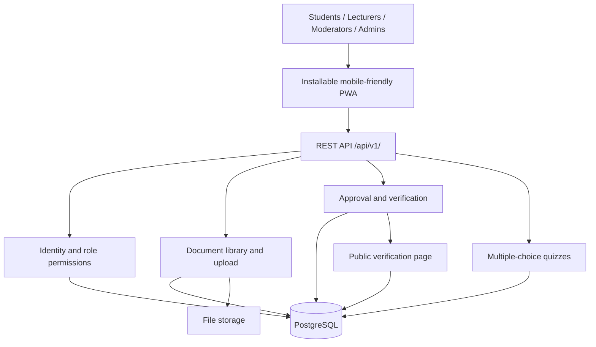

# Initial Threat List

1. **Unauthorized access:** Users may access accounts or features they are not permitted to use.
2. **Privilege escalation:** A user may gain permissions intended for moderators or administrators.
3. **Credential attacks:** Attackers may guess, steal, or reuse passwords to access accounts.
4. **Malicious document uploads:** Uploaded files may contain malware or unsafe content.
5. **Sensitive file exposure:** Documents in file storage may be accessed by people without permission.
6. **API abuse:** Attackers may send invalid, excessive, or crafted requests to the REST API.
7. **Database compromise:** Weak access controls or injection vulnerabilities may expose or alter PostgreSQL data.
8. **Verification-token misuse:** QR codes or verification tokens may be guessed, copied, or reused to impersonate a valid verification.
9. **Unauthorized record changes:** Approval, verification, quiz, or library records may be altered without authorization.
10. **Service disruption:** Excessive requests or other attacks may make the application unavailable.
11. **Data loss:** Database or file-storage failures, accidental deletion, or inadequate backups may cause loss of records.
12. **Insufficient monitoring:** Missing logs, alerts, or health checks may delay detection of suspicious activity or failures.

# Architecture Diagram

