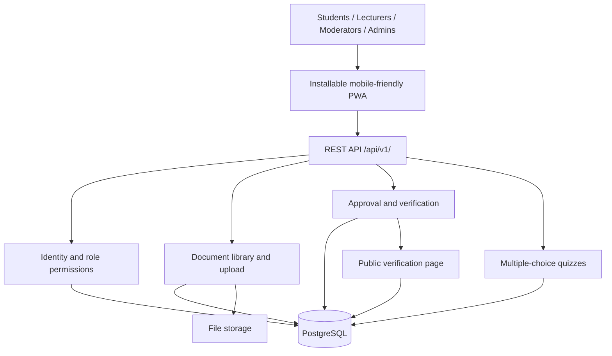

# Architecture Diagram

The concept paper suggests (not mandates) a PWA client, REST API with authentication/validation, logical Identity, Papers, Verification, Library, Search, Moderation and Notifications modules, relational data plus file storage, optional background jobs, and deployment with CI/logging/monitoring.

The diagram below is an initial sketch. Review and adjust it as a team; label mandatory and optional components in the final design.

Decide and document hosting/reverse proxy, file storage, auth boundaries, QR token handling, backups/monitoring/health checks, and deferred modules.
