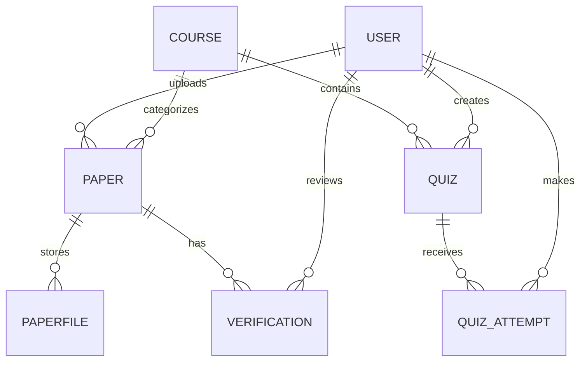

# Data Model and ERD

The concept paper lists these core entities: `User`, `Role`, `Course`, `Paper`, `PaperFile`, `Verification`, `Rating`, `Report`, `LibraryItem`, `Tag`, `AuditLog`, and `ApiClient`. Define fields, relationships, constraints and which optional entities are in scope.

| Entity | Purpose / note |
|---|---|
| User | Account; minimize personal data |
| Role | Role-based access and assignments |
| Course | Course code/title; links papers and quizzes |
| Paper | Metadata and workflow state |
| PaperFile | Stored file metadata/location; validate type/size |
| Verification | Approval record and public token/status; Verified/Revoked |
| Rating | Optional quality feedback |
| Report | Content reports; simple report action is enough for minimum |
| LibraryItem | Notes/books/links; stretch unless scope changes |
| Tag | Optional classification |
| AuditLog | Traceable moderation/security actions; scope to decide |
| ApiClient | External client/scopes; implementation details to decide |

## Initial ERD sketch — must be reviewed

Quiz-related entities are implied by the required quiz behaviour but not named in the core list; confirm names/relationships in the team's ERD.
