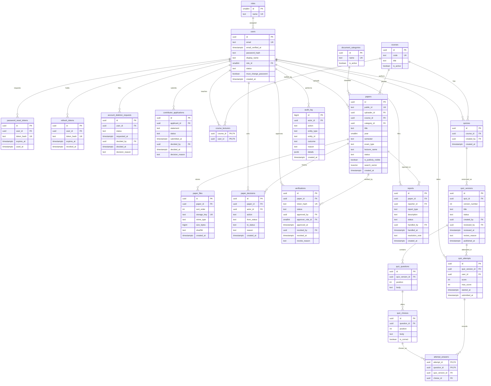

# TuStudyHub Data Model

Owner: madisonjuah1-hue (DB / Database Engineer)
Status: Draft for team review. Not approved until the team and lecturer confirm it.
Database: PostgreSQL (recommended in the SDD, pending team confirmation)
Editable ERD source: `docs/design/erd.mmd` (Mermaid)
Reference schema: `docs/design/schema_reference.sql` (a reviewable draft, not an applied migration)

---

## 1. Sources and approach

Documents used for this review:

- `REQUIREMENTS.md` (SRS Draft 1.1) is the baseline. Its section 1.1 (in scope) defines the mandatory model; section 1.2 (optional) is kept out of the baseline.
- `SYSTEM_DESIGN_DOCUMENT.md` (SDD Draft 1.0) for workflow, verification, quiz and backup design.
- `API_SPECIFICATION.md` (contract draft) for the resource inventory.
- The previous `DATA_MODEL.md` (concept paper entity list and initial ERD sketch).

All of these are working drafts. Where they disagree, this model follows the SRS and the disagreement is recorded in section 12 for the team to resolve. No unapproved feature was added to the baseline.

## 2. Disposition of the concept-paper entities

| Concept-paper entity | Disposition | Where |
|---|---|---|
| User | Baseline | `users` |
| Role | Baseline | `roles` (one primary role per account, SRS 2.8) |
| Course | Baseline | `courses`, plus `course_lecturers` for lecturer scope |
| Paper | Baseline | `papers` |
| PaperFile | Baseline | `paper_files` |
| Verification | Baseline, split in two | `paper_decisions` (review history) and `verifications` (QR token and approval/revocation record) |
| Report | Baseline | `reports` (a simple report action is enough, per the previous draft) |
| AuditLog | Baseline | `audit_log` (mandatory: FR-070, FR-071) |
| Rating | Optional (FR-026) | Section 11 only |
| Tag | Not named in the SRS | Section 11 only |
| LibraryItem | Stretch, outside first release | Not modelled |
| ApiClient | Undecided (API spec: "only if selected") | Section 11 only |

Quiz entities were not in the concept-paper list but are required by FR-037 to FR-045, so they are in the baseline.

## 3. Entity inventory and traceability

| Entity | Purpose | Requirements |
|---|---|---|
| `roles` | Student, verified contributor, lecturer, moderator, administrator | FR-004, SRS 2.8 |
| `users` | Accounts, status, role, forced password change | FR-001, 002, 004, 008, 010, NFR-001, NFR-005 |
| `password_reset_tokens` | Self-service password recovery | FR-003 |
| `refresh_tokens` | Token expiry and revocation (**conditional** on the approved auth design) | FR-002, FR-055 |
| `account_deletion_requests` | Reviewed deletion requests | FR-036, NFR-006 |
| `contributor_applications` | Apply, approve or reject, reapply with history kept | FR-005, 006, 007 |
| `courses` | Course catalogue | FR-011 to 013, FR-018 |
| `course_lecturers` | Which lecturers are authorized for which courses | SRS 2.4, 2.8, FR-030 |
| `document_categories` | Administrator-configurable categories | FR-015 |
| `papers` | Metadata, required fields, workflow state, public identifier, visibility | FR-015 to 021, 027 to 029, 046, 067 |
| `paper_files` | Stored file metadata (PDF and image formats) | FR-016, 019, 021, NFR-003 |
| `paper_decisions` | Review and moderation history with actor, reason, time | FR-028 to 034, 031, 052 |
| `verifications` | QR token (hashed), approval and revocation records | FR-046 to 052 |
| `reports` | Content reports and their handling | FR-022, FR-030 |
| `quizzes` | Quiz identity per course | FR-037 |
| `quiz_versions` | Versioned content, review, publication | FR-038 to 040 |
| `quiz_questions`, `quiz_choices` | Questions and answer options | FR-037, 042 |
| `quiz_attempts`, `attempt_answers` | Attempts, scores, tied to the exact version | FR-041 to 044 |
| `audit_log` | Security and administrative actions | FR-052, FR-070, FR-071 |

Not stored as tables because they are rules or computed: the permission matrix per role (enforced in code), dashboard counts and reports (queries, FR-068, 069), health checks (FR-072, logs).

## 4. ERD

## 5. Keys and relationships

| Table | Primary key | Foreign keys | Unique rules |
|---|---|---|---|
| `roles` | `id` | none | `name` |
| `users` | `id` | `role_id` to `roles` | `email` (lowercase) |
| `password_reset_tokens` | `id` | `user_id` to `users` | `token_hash` |
| `refresh_tokens` | `id` | `user_id` to `users` | `token_hash` |
| `account_deletion_requests` | `id` | `user_id`, `decided_by` to `users` | one pending request per user |
| `contributor_applications` | `id` | `applicant_id`, `decided_by` to `users` | one pending application per applicant |
| `courses` | `id` | none | `code`, case-insensitive |
| `course_lecturers` | `(course_id, user_id)` | `course_id` to `courses`; `user_id` to `users` | the primary key |
| `document_categories` | `id` | none | `name` |
| `papers` | `id` | `uploader_id` to `users`; `course_id` to `courses`; `category_id` to `document_categories` | `public_id` |
| `paper_files` | `id` | `paper_id` to `papers` | `storage_key`; `(paper_id, sort_order)` |
| `paper_decisions` | `id` | `paper_id` to `papers`; `actor_id` to `users` | none |
| `verifications` | `id` | `paper_id` to `papers`; `approved_by`, `revoked_by` to `users`; `approver_role_id` to `roles` | `token_hash`; one active verification per paper |
| `reports` | `id` | `paper_id` to `papers`; `reporter_id`, `handled_by` to `users` | none |
| `quizzes` | `id` | `course_id` to `courses`; `created_by` to `users` | none |
| `quiz_versions` | `id` | `quiz_id` to `quizzes`; `created_by`, `reviewed_by` to `users` | `(quiz_id, version_number)`; one published version per quiz |
| `quiz_questions` | `id` | `quiz_version_id` to `quiz_versions` | `(quiz_version_id, position)`; `(id, quiz_version_id)` |
| `quiz_choices` | `id` | `question_id` to `quiz_questions` | `(question_id, position)`; `(id, question_id)` |
| `quiz_attempts` | `id` | `quiz_version_id` to `quiz_versions`; `user_id` to `users` | `(id, quiz_version_id)` |
| `attempt_answers` | `(attempt_id, question_id)` | `(attempt_id, quiz_version_id)`; `(question_id, quiz_version_id)`; `(choice_id, question_id)` | the primary key |
| `audit_log` | `id` | `actor_id` to `users` (nullable) | none |

Main relationships, all one-to-many unless stated: a role has many users; a user uploads many papers, files many reports and has many quiz attempts; a course has many papers and quizzes and many authorized lecturers (many-to-many through `course_lecturers`); a paper has many files, decisions, verifications and reports; a quiz has many versions; a version has many questions and attempts; a question has many choices; an attempt has many answers.

## 6. Constraints and uniqueness rules

Enforced by the database:

- Each account has exactly one role (`users.role_id`, not null).
- Email is unique and lowercase. Account status is `pending`, `active`, `suspended` or `deactivated`.
- Course codes are unique ignoring case.
- Paper status is one of the seven SRS states (`submitted`, `under_review`, `approved`, `rejected`, `restricted`, `removed`, `revoked`). An approved paper must have a `public_id`.
- Paper year, course, category and title are required (FR-017); semester, exam type and lecturer name are optional.
- A paper decision for reject, restrict, remove, restore or revoke must have a non-empty reason (FR-031, 032, 033, 034).
- Only tokens' hashes are stored (QR, password reset, refresh).
- A paper has at most one active verification. A revoked verification must record who revoked it, when and why, and it is kept as history.
- A contributor application rejection must have a reason, and the decider cannot be the applicant. A user has at most one pending application, and earlier decisions stay as rows (FR-006).
- A quiz version's reviewer cannot be its author (FR-038). A quiz has at most one published version. Published or superseded versions must have a reviewer and publish time; a rejected version must have a reason.
- Every attempt references one quiz version (FR-044). An answer's question belongs to the attempt's version, and its chosen option belongs to that question, enforced by composite foreign keys.
- Scores are between 0 and `max_score`; `submitted_at` is not before `started_at`.

Enforced by application logic (the database cannot express them simply, and each needs a test):

- Valid paper state transitions and who may perform them (FR-029; transitions not yet defined).
- A paper's reviewer is not its uploader; reviewers act only within their authorized courses.
- Paper status, decision rows, verification status and audit rows change together in one transaction.
- Public verification shows "approved" only when the paper is `approved` **and** its verification is `active` (FR-050).
- Published quiz versions are immutable; revisions are new versions. Publishing a revision marks the previous version `superseded` in the same transaction.
- Answer keys (`quiz_choices.is_correct`) are never returned before the permitted stage.
- Audit records are append-only: grant the application database role `INSERT` and `SELECT` only on `audit_log` (FR-071).

## 7. Normalization review

The model is in third normal form. Courses, categories, roles and files are stored once and referenced. Deliberate redundancy, each with a reason:

- `papers.status` duplicates the latest `paper_decisions` row, for fast filtering. Both are written in one transaction.
- `attempt_answers.quiz_version_id` repeats the attempt's version so composite keys can guarantee the version consistency above.
- `verifications.approver_role_id` records the role at approval time, because a user's role can change later (needed for the stamp, FR-048).
- `quiz_attempts.score` is derivable from answers; it is stored so history remains correct if rules change.

## 8. Index plan

| Index | Workflow |
|---|---|
| `papers (course_id, status)`, `(category_id)`, `(year)` | Browse and filter (FR-020) |
| `papers` GIN on `search_vector` (title) | Title search (FR-020) |
| `papers (status, created_at)` | Review and moderation queues |
| `papers (uploader_id)` | A user's own submissions |
| `paper_decisions (paper_id, created_at)` | Review history |
| `verifications (token_hash)` (unique) | Public QR lookup |
| `verifications (paper_id)` and partial unique on active | Current status and one-active rule |
| `reports (status, created_at)`, `(paper_id)` | Moderator report queue |
| `quiz_attempts (user_id, started_at DESC)` | Student attempt history (FR-043) |
| `course_lecturers (user_id)` | Courses a lecturer may review |
| `audit_log (entity_type, entity_id)`, `(actor_id)`, `(created_at)` | Audit review |

Search on course code uses the unique code index through a join. Search by title uses full-text search with the `simple` configuration, so no language is assumed; the search approach is open decision D12. Foreign key columns used in joins are indexed because PostgreSQL does not do that automatically.

## 9. Referential integrity and deletion

- Users, papers, courses, quizzes and quiz versions use `ON DELETE RESTRICT`, so history is never lost by accident. Child rows that have no meaning alone use `CASCADE` (tokens, lecturer assignments, questions, choices).
- Proposal for FR-035 and FR-036: users are not hard-deleted. A reviewed deletion request is completed by anonymizing personal fields while keeping the row, so audit and review history stay valid. Permanent deletion of a paper is a documented procedure that removes its dependent rows and its file, while `audit_log` keeps the event. Retention periods are not yet decided (D8).

## 10. API consistency

The API specification lists resources but not yet exact endpoints, so only the resource level can be checked.

| API resource | Tables |
|---|---|
| Auth/sessions | `users`, `password_reset_tokens`, `refresh_tokens` |
| Users | `users`, `roles`, `contributor_applications`, `account_deletion_requests` |
| Courses | `courses`, `course_lecturers` |
| Papers | `papers`, `paper_files`, `document_categories` |
| Verification (review, approve, reject, revoke, public lookup) | `paper_decisions`, `verifications` |
| Quizzes | `quizzes`, `quiz_versions`, `quiz_questions`, `quiz_choices` |
| Quiz attempts | `quiz_attempts`, `attempt_answers` |
| Reports | `reports` |
| API clients | Not in baseline (section 11) |

Needs confirmation from the API Designer once endpoints exist: that "Verification" operations map to the two tables above, that list/search filters match the indexes, and that no response exposes `is_correct`, `storage_key`, `token_hash` or reviewer notes.

## 11. Optional extensions (not in the baseline)

The SRS says these are not part of the first release unless approved. They are intentionally absent from the ERD and reference schema.

| Feature | Requirement | What it would add |
|---|---|---|
| Enrollment, academic calendar, course offerings | SRS 1.2, FR-018 | `terms`, `course_offerings`, `enrollments`; `papers` would link to an offering |
| Document version history | FR-024, 025 | `paper_versions`; files and decisions would attach to a version |
| Duplicate detection | FR-023 | An index on `paper_files.sha256` (the column already exists) |
| Ratings | FR-026 | `ratings` (user, paper, value; one per user and paper) |
| Tags | not in SRS | `tags`, `paper_tags` |
| Formal appeals | FR-009 | `appeals` linked to account status or decisions |
| Notifications | FR-066 | `notifications` |
| API clients and scopes | FR-056 | `api_clients`, `api_client_scopes` |
| Course change requests | FR-014 | A request table if changes need review (policy undecided) |
| Library items | outside first release | Not planned |

## 12. Inconsistencies found in the source documents

1. **Scope:** SDD 1.2, 3.2 and 5.1 put enrollment, offerings, version history, appeals, notifications and offline reading in the first release; SRS 1.2 calls them optional. This model follows the SRS.
2. **File formats:** SDD 5.3 says PDF only; SRS FR-016 says PDF and images. The model handles both (`mime_type`).
3. **Requirement count:** SDD 2 says FR-001 to FR-073; the SRS ends at FR-072. SRS FR-046 and FR-047 are identical duplicates.
4. **Rating and Tag:** SDD 5.1 says both are included in the SRS; the SRS lists ratings as optional and does not mention tags.
5. **Appeals:** SDD 9 says suspended users can sign in to appeal; SRS makes appeals optional.
6. **Roles:** an earlier draft allowed several roles per user; the SRS says one primary role, which this model follows.
7. **Verification:** the old ERD sketch used `Verification` for both review and QR data; they are now separate.

## 13. Migration considerations

- The reference schema creates tables in dependency order and seeds the five roles and three document categories from the SRS. It requires PostgreSQL 13 or newer.
- If the team adopts SQLAlchemy and Alembic (SDD recommendation, pending), the schema should become Alembic revisions. Do not run the reference file and Alembic against the same database.
- Add later changes as new numbered migrations. Never edit one already applied.
- Optional tables in section 11 arrive in separate migrations only after approval.
- Moving to paper versions later would need a data migration: existing `paper_files` and `paper_decisions` rows would be attached to a first version.
- `refresh_tokens` and `papers.is_publicly_visible` depend on the authentication design and publication policy (D2, D9). They are easy to drop or change before first deployment.
- Test every migration on an empty database and on a copy with sample data. Keep a rollback step.
- Seed data: roles and categories only. The first administrator is provisioned by a controlled process, not seed data (FR-010).

## 14. Backup and recovery requirements and dependencies

From NFR-015, NFR-007 and SDD sections 10 and 12:

- Backups must cover the database **and** stored files, and be coordinated so restored records do not point to missing files.
- Backup and restoration procedures must be documented and tested before production release.
- After a test restore, run a consistency check: every `paper_files.storage_key` must exist in storage, and the stored `sha256` can be used to verify file integrity.
- Proposed: a nightly database dump and file backup with a documented retention period, stored away from the database host. Concrete schedule, recovery time and recovery point targets are not decided (D10).
- Access to backups must be restricted, because they contain personal data and the audit log.
- Backups hold deleted-account data until they expire. Retention (D8) must account for this.

Dependencies: hosting provider and file-storage choice (SRS open questions 2 and 12), retention policy (question 4), and the ARCH and OPS roles for the deployment procedure.

## 15. Unresolved decisions and coordination

| ID | Decision | Suggested owner |
|---|---|---|
| D1 | Which SRS 1.2 optional features are approved (section 11)? | PO |
| D2 | Authentication and token design (keep `refresh_tokens`?) | ID |
| D3 | Final paper state transitions and who approves each category | CORE, PO |
| D4 | Resubmission after rejection: replace the file, add a file, or enable versioning (FR-032 vs FR-024) | CORE |
| D5 | Can one paper have several files (for example photographed pages)? Baseline allows it; confirm. | CORE, API |
| D6 | Is exactly one correct choice per question required? Quiz access rules for students | CORE |
| D7 | Allowed file formats and maximum size | ARCH, SEC |
| D8 | Retention periods for accounts, papers, audit records, backups | PO, SEC |
| D9 | Publication and indexing policy (does `is_publicly_visible` match it?) | PO |
| D10 | Backup schedule, recovery targets, hosting | ARCH, OPS |
| D11 | Behaviour of `pending` accounts (SRS question 6) | ID, PO |
| D12 | Search approach (title full-text, course code, filters) | API, CORE |
| D13 | Are course changes reviewed (FR-014), and who may request them? | PO |
| D14 | Fix the SRS duplicate FR-046/047 and the SDD scope text (section 12) | PO, ARCH |

Coordination: Joseph (CORE: papers, verification, revocation, quizzes) should review D3, D4, D5, D6. Darius's role is not stated in the files I had, so confirm who owns the API contract and send D5, D12 and section 10 to that person.

## 16. Acceptance checklist

- [x] Every baseline entity is traced to requirement IDs (section 3).
- [x] Primary keys, foreign keys and relationships are identified (section 5).
- [x] Constraints and uniqueness rules are documented (section 6).
- [x] Unapproved scope is excluded and listed separately (section 11).
- [x] Migration, backup and recovery notes are included (sections 13 and 14).
- [x] Source inconsistencies and open decisions are recorded (sections 12 and 15).
- [ ] Consistency with the API confirmed (waiting for exact endpoints).
- [ ] Team review by CORE and the API owner.
- [ ] Pull request link added to the issue.
