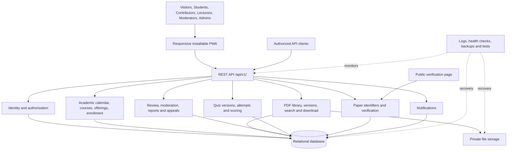

# System Design Document (SDD) — TuStudyHub

**Status:** Working design for team review; not yet approved
**Review target:** 27 October 2026
**Final project deadline:** 17 November 2026
**Version:** Draft 1.0

> This document distinguishes requirements from recommendations. Pending technology, hosting, budget, retention, and policy decisions must not be treated as approved until confirmed by the team or lecturer.

## 1. Purpose, problem, and users

### 1.1 Purpose

TuStudyHub is an Open Student Past Papers & Library Platform. It is intended to provide a searchable academic document library, multiple-choice quizzes, and public verification of approved academic papers. The planned application is responsive and installable as a Progressive Web App (PWA) on compatible devices.

The design translates the requirements in [REQUIREMENTS.md](../requirements/REQUIREMENTS.md) into a proposed architecture, data model, API, security controls, and operational approach.

### 1.2 Goals and scope

The first release covers account management and permissions, academic calendar and course offerings, student enrollment, PDF academic materials, document review and version history, search, quizzes, moderation and appeals, QR verification, a REST API, notifications, administration reports, and safe offline reading of explicitly saved public materials.

Live/current examinations, private grades and academic records, payments, Q&A forums, SMS/WhatsApp, and advanced analytics are outside the current scope unless the team formally changes it.

### 1.3 Users

- **Visitor:** browses eligible public pages and checks public verification records.
- **Student:** accesses basic student features, enrolls in course offerings under the agreed policy, reads eligible materials, and takes quizzes.
- **Verified Contributor:** submits permitted materials and performs actions allowed by assigned permissions.
- **Lecturer:** handles authorized course-related activities and reviews or creates materials and quizzes as permitted by the final role policy.
- **Moderator:** reviews reports and performs authorized content restrictions with recorded reasons.
- **Administrator:** manages accounts, permissions, academic structure, categories, review oversight, appeals, audit records, and configuration.
- **External API client:** accesses explicitly authorized API resources within granted scopes.

Each account has one primary role. The backend must enforce permissions; hiding a frontend control is not sufficient authorization.

### 1.4 User research

The project outline requires interview findings from at least five classmates. Interview dates, anonymized findings, and resulting design changes must be documented in [USER_INTERVIEWS.md](../requirements/USER_INTERVIEWS.md). This document does not invent interview results.

## 2. Requirements and traceability

The working SRS in [REQUIREMENTS.md](../requirements/REQUIREMENTS.md) is the primary requirements reference. It defines functional requirements FR-001 through FR-073 and non-functional requirements NFR-001 through NFR-016.

| Design area | Supporting document |
|---|---|
| Requirements and acceptance criteria | [REQUIREMENTS.md](../requirements/REQUIREMENTS.md) |
| Architecture | [ARCHITECTURE.md](ARCHITECTURE.md) |
| Data model and relationships | [DATA_MODEL.md](DATA_MODEL.md) |
| Technology choices | [TECHNOLOGY_DECISIONS.md](TECHNOLOGY_DECISIONS.md) |
| API contract | [API_SPECIFICATION.md](../api/API_SPECIFICATION.md) |
| Security threats | [THREAT_MODEL.md](../security/THREAT_MODEL.md) |
| Testing | [TEST_STRATEGY.md](../testing/TEST_STRATEGY.md) |
| Deployment and recovery | [DEPLOYMENT_AND_RECOVERY.md](../operations/DEPLOYMENT_AND_RECOVERY.md) and [INFRASTRUCTURE_REPORT.md](../operations/INFRASTRUCTURE_REPORT.md) |
| Team responsibilities and dates | [TEAM_AND_TASK_PLAN.md](../planning/TEAM_AND_TASK_PLAN.md) |

Requirements should be traceable to design elements and tests. Changes to requirements or major design decisions must be reflected in the affected supporting documents.

## 3. Proposed architecture

### 3.1 Architectural style

**Recommendation pending team confirmation:** use a modular monolithic backend for the first release. A single backend application exposes the REST API while keeping identity, academic records, document workflow, quizzes, verification, and moderation separated into logical modules.

This approach avoids the additional deployment and monitoring overhead of microservices for the current project scope.

### 3.2 Logical components

1. **PWA client:** responsive pages, account flows, search, enrollment, quizzes, authorized administration screens, and safe offline reading.
2. **API layer:** versioned REST/JSON routes under `/api/v1/`, request validation, consistent errors, pagination, and API documentation.
3. **Identity and access:** registration, sign-in, recovery, role checks, contributor applications, account status, and appeals.
4. **Academic module:** academic calendar, courses, course offerings, and enrollment.
5. **Document module:** PDF upload, metadata, duplicate warnings, version history, search, and authorized downloads.
6. **Review and moderation:** review decisions, rejection reasons, reports, restrictions, appeals, restoration decisions, and audit events.
7. **Quiz module:** quiz authoring, review, versioning, questions, choices, attempts, and scoring.
8. **Verification module:** stable paper identifiers, non-guessable tokens, public verification, and revocation history.
9. **Notification module:** in-app and email notifications, with browser push where supported and configured.
10. **Operations:** logs, health checks, automated tests, migrations, backup/restore, and deployment checks.

### 3.3 Logical architecture diagram

This is a proposed design, not a claim that every component has already been implemented or deployed.

### 3.4 Trust boundaries

Browsers and external API clients are untrusted. The server must recheck authorization and workflow rules for every protected action. Uploaded PDFs are untrusted input and must be validated before publication.

The database stores structured records and file references. Restricted files must not be exposed through a public storage directory. The public verification page returns only deliberately selected public metadata. The exact file-storage mechanism, reverse proxy, and hosting environment remain pending decisions.

## 4. Technology choices

The current recommendations are recorded in [TECHNOLOGY_DECISIONS.md](TECHNOLOGY_DECISIONS.md).

| Area | Recommendation | Status |
|---|---|---|
| Backend | Python + FastAPI | Pending team confirmation |
| Database | PostgreSQL | Pending team confirmation |
| Database access and migrations | SQLAlchemy + Alembic | Pending team confirmation |
| Frontend | HTML, CSS, JavaScript | Pending team confirmation |
| API | REST/JSON under `/api/v1/` | Required design target; exact contract pending |
| PWA | Web app manifest and service worker | Required; implementation plan pending |
| API documentation | OpenAPI and interactive documentation | Recommended with FastAPI |
| Tests | pytest + HTTPX | Pending team confirmation |
| Python code quality | Ruff | Pending team confirmation |
| Collaboration | GitHub Issues, branches, reviewed pull requests | Confirm team/lecturer expectations |
| Hosting | Linux VPS, domain, HTTPS, Cloudflare-managed DNS | Provider, cost, owner, and setup pending |

The proposed stack follows the project proposal without adding a separate frontend framework unnecessarily. Django REST Framework and React with TypeScript remain alternatives if the team identifies a clear need. Separate microservices are not recommended for the first release.

The stack must not be described as approved until confirmed. Technology selection alone does not guarantee security, performance, accessibility, or offline operation; these qualities require implementation and tests.

## 5. Data model and storage

The detailed ERD belongs in [DATA_MODEL.md](DATA_MODEL.md). The following entity groups must be represented in the reviewed data model.

### 5.1 Entity groups

- **Identity:** User, role/permission assignment or equivalent, contributor application, account-status history, and appeals.
- **Academic structure:** academic calendar or term, Course, CourseOffering, and Enrollment. A reusable course must be distinct from its term-specific offering and a student's enrollment.
- **Documents:** Paper, PaperVersion, PaperFile, review decision/history, and verification record/token.
- **Quizzes:** Quiz, QuizVersion, QuizQuestion, QuizChoice, and QuizAttempt.
- **Moderation:** Report, restriction/removal decision, appeal, and AuditLog.
- **Supporting records:** Notification and API client/scope records where required. Rating and Tag are included in the SRS. LibraryItem remains outside the first release unless scope changes.

### 5.2 Relationships and integrity

1. A user may submit multiple papers; each paper records its uploader.
2. A paper may have multiple versions. Each version references its stored file metadata and retains its review history.
3. Papers link to the relevant course offering where applicable, with exceptions defined for materials not tied to a specific offering.
4. Enrollment links a student to a specific course offering. Enrollment rules and add/drop windows remain open until agreed.
5. Review decisions record the reviewer, outcome, reason, and time. Authors must not approve their own submissions or revisions.
6. Each quiz version contains its own questions and choices. Every attempt references the exact version taken.
7. Verification identifiers must be unique and tokens non-guessable. Public endpoints return limited metadata.
8. Audit records capture important workflow and security actions. Retention and access policy require team/university confirmation.
9. Required fields, uniqueness, valid state transitions, foreign keys, and search indexes must be defined in the reviewed ERD/schema and tested.

### 5.3 PDF storage

The first release accepts PDF files only. The implementation must enforce a team-approved size limit, inspect file signatures rather than trusting extensions alone, generate safe server-side filenames, and reject invalid files. Malware scanning should be considered where supported.

Files should be stored outside executable/public application paths. Every protected download must be authorized. Duplicate detection should warn using file hashes and relevant metadata; it must not silently delete a submission. File-storage choice, size limits, and scanning capability remain open decisions.

## 6. API design

The API contract is maintained in [API_SPECIFICATION.md](../api/API_SPECIFICATION.md). The design target is REST/JSON under `/api/v1/`. Exact routes and methods must be completed and reviewed before implementation.

### 6.1 Resource groups

- Authentication, recovery, account status, and users.
- Contributor applications, role administration, and appeals.
- Academic calendar, courses, course offerings, and enrollment.
- Papers, versions, uploads/downloads, reviews, and search.
- Public verification lookup and authorized status changes.
- Quizzes, versions, questions, choices, attempts, and results.
- Reports, restrictions, moderation decisions, and audit history.
- Notifications and administrator reports.
- External API clients and scopes if selected.

### 6.2 Authentication and authorization

The final authentication mechanism and token/session lifecycle are pending confirmation. The implementation must use secure password hashing, safe recovery, server-side authorization, and explicit scopes for external clients.

The selected design must define expiry, refresh, logout/revocation, and secure token storage. Secrets must not be committed to source control or written to logs.

Public verification is read-only. Administrative and moderation actions require appropriate permissions and should create audit records. The backend must deny unauthorized direct API calls even when a user bypasses the frontend.

### 6.3 Errors, pagination, and documentation

Use the proposed error envelope containing `code`, `message`, and `request_id`. Do not return stack traces, secrets, or unnecessary personal information. Paginated endpoints should use a consistent documented scheme and enforce reasonable page limits.

Provide interactive API documentation through the selected framework where supported. Automated API tests should cover success, validation errors, authentication failures, authorization failures, pagination, and error structure.

## 7. Paper workflow and verification integrity

### 7.1 Review and publication

The SRS lists the working paper states as Submitted, Under Review, Approved, Rejected, Restricted, Removed, and Revoked. The exact transitions and authorized actors must be confirmed in the supporting workflow design.

Recommended workflow:

1. An authorized user submits PDF content and metadata.
2. The system validates the submission and may flag a likely duplicate.
3. A designated reviewer checks academic suitability and content rights.
4. Approval makes the paper eligible for publication only if its visibility and distribution permissions also allow publication.
5. Rejection requires a clear reason and correction guidance. Corrected submissions retain previous versions and decisions.
6. A report or credible copyright/privacy concern may trigger a restriction while the case is reviewed.
7. An authorized administrator reviews restoration requests and recorded moderation reasons. Academic reapproval is completed where required.
8. Removed or revoked content must no longer appear as currently verified. Preserve appropriate status history under the approved retention policy.

Academic approval does not automatically grant permission for public distribution or search-engine indexing. Visibility must be explicitly authorized, and access restrictions must be enforced by the server.

### 7.2 QR verification

Each eligible paper should have a stable public identifier and a cryptographically random, non-guessable verification token. The token must not be a sequential database ID or contain private user data. Use HTTPS for the verification page.

The public response should contain only approved fields, such as title, identifier, current status, and selected public metadata. It must not expose private notes, restricted files, personal information, reviewer discussions, or storage paths.

The page must distinguish current valid status from revoked, removed, restricted, unknown, or otherwise invalid records. Revocation must invalidate the current verification result without erasing required historical evidence.

### 7.3 Audit

Record important events such as submission, review, rejection, publication, restriction, restoration, revocation, and administrator changes. Where applicable, capture the actor, action, target, timestamp, reason, and outcome. Do not store passwords, authentication tokens, or unnecessary sensitive data in audit logs.

## 8. Quiz design

Lecturers and explicitly authorized contributors may create quizzes according to the final permission policy. A lecturer or designated reviewer approves a quiz version before publication. Authors must not approve their own work.

Editing a published quiz creates a new version that must be reviewed. The current published version should remain available during review unless a separate safety or integrity concern requires otherwise. A rejected revision must not silently replace the current published version.

Students may make unlimited attempts under the current SRS. Each attempt retains its score and exact quiz-version reference. The score and correct answers are displayed after submission. Unauthorized users must not obtain answer keys before the permitted stage.

## 9. Security, privacy, and moderation

The detailed threat register is in [THREAT_MODEL.md](../security/THREAT_MODEL.md). The design considers account compromise, privilege escalation, unsafe uploads, unauthorized distribution, misleading verification, data loss, poor connectivity, and excessive personal-data collection.

Required controls include:

- Secure password hashing and account recovery.
- Server-side role and resource authorization for protected operations.
- PDF validation, safe storage, authorized downloads, and protection against path traversal or executable-file exposure.
- HTTPS in production and secrets kept outside source control.
- Data minimization and restricted public verification output.
- Audited moderation and security decisions.
- Clear suspension/deactivation reasons and an appeal path.
- Authorized restrictions while copyright/privacy complaints are reviewed.
- Safe error responses and logs that exclude credentials, tokens, and private file contents.
- Separate retention policies for accounts, files, and audit records.

Suspended/deactivated users may sign in to see their status and appeal, but protected actions remain blocked. Deletion requests remain subject to approved retention obligations and review.

The first administrator account must be provisioned through a controlled process, not public administrator registration, and required to change its initial credentials securely. Administrator-account recovery remains to be defined.

## 10. Low bandwidth, reliability, and performance

The system is intended for phone-first use and inconsistent connectivity. Favor lightweight responsive pages, compressed assets, pagination, explicit loading/error states, and retryable uploads. Failed uploads must not be reported as successful, and retries should avoid accidental duplicate submissions.

Offline reading is limited to explicitly saved eligible public materials. Restricted/private content must not be cached. The interface should explain that saved copies may be outdated and synchronization requires connectivity. Offline support does not mean verification, enrollment changes, quiz submissions, or moderation actions can safely complete without a connection.

Provide health checks, structured logs, and alerts where supported. Coordinate database and file backups so restored records do not point to missing files. Test restoration, not only backup creation.

Set measurable performance targets after selecting a hosting environment and testing realistic data and traffic. Do not claim targets have been achieved before measurement.

## 11. Testing and quality assurance

The detailed plan is in [TEST_STRATEGY.md](../testing/TEST_STRATEGY.md). The test approach should include:

- **Unit tests:** validation, permission checks, state transitions, scoring, and token validation.
- **API integration tests:** database operations, authentication, authorization, pagination, errors, upload rules, and version relationships.
- **End-to-end tests:** registration/recovery, enrollment, upload/review, search/download, quiz attempts/results, reports/appeals, and QR verification/revocation.
- **Security tests:** privilege escalation, unauthorized downloads, upload validation, public-data leakage, token guessing resistance, and unsafe errors.
- **Usability/accessibility tests:** responsive layouts, keyboard access, clear errors, and low-bandwidth behavior.
- **Deployment/recovery tests:** HTTPS, health checks, migrations, backup restoration, and file/database consistency.

Use the automated checks agreed by the team. The contribution workflow requires reviewed pull requests rather than direct commits to `main`; another team member should review and approve a pull request. Confirm required CI checks and branch-protection capabilities.

## 12. Deployment and recovery

The project proposal targets a Linux VPS, registered domain, and HTTPS. Provider, capacity, cost, domain ownership, and setup remain pending. See [INFRASTRUCTURE_REPORT.md](../operations/INFRASTRUCTURE_REPORT.md) and [DEPLOYMENT_AND_RECOVERY.md](../operations/DEPLOYMENT_AND_RECOVERY.md).

The deployment plan should cover:

1. Supported Linux environment and documented application service.
2. Reverse proxy or equivalent HTTPS termination and domain/DNS configuration.
3. Secrets supplied outside source control.
4. Reviewed database migration and release process.
5. Restricted PDF storage and appropriate backups.
6. Health checks, logs, capacity monitoring, and alerts where available.
7. Tested database-and-file backup and restore procedure.
8. Rollback plan and process for rotating compromised secrets.
9. Post-deployment checks for sign-in, search, upload/review, quiz submission, QR verification, and restricted access.
10. Named responsibility for domain renewal, updates, backup checks, and incident response.

Do not deploy private student information or copyrighted materials without authorization. Use test data for development and demonstrations where possible.

## 13. Risks and open questions

| Risk or open question | Impact | Required follow-up |
|---|---|---|
| Stack and workflow not confirmed | Affects implementation and tooling | Team and lecturer review |
| Hosting, budget, and domain owner unknown | Production plan incomplete | Compare providers, costs, and capacity |
| Interview evidence incomplete or not attached | User needs not yet evidenced | Document interviews with at least five classmates |
| Authentication and token lifecycle undefined | Security depends on these decisions | Define expiry, recovery, revocation, and storage |
| File limits, storage, and scanning undecided | Affects safe uploads and capacity | Agree limits and test validation/recovery |
| Enrollment/add-drop policy undecided | Affects permissions and enrollment states | Agree rules and semester boundaries |
| Basic access while approval is pending needs detail | Affects user experience | Define allowed and protected actions |
| Publication rights and review boundaries need confirmation | Approval may not authorize public distribution | Define rights, visibility, and review authority |
| Moderation restoration and retention undecided | Affects privacy and evidence preservation | Agree restriction, appeal, restoration, and deletion |
| Audit/account/file retention periods unknown | Affects privacy and accountability | Confirm with university/team |
| Performance and recovery targets unmeasured | Capacity and service expectations uncertain | Measure after provider selection |
| Notification delivery depends on providers | Delivery may fail or require setup | Select mechanism and define failure behavior |
| License and repository checks need confirmation | Affects submission workflow | Confirm license and required automated checks |

These are open items, not claims that all work is blocked. Assign owners and due dates in [TEAM_AND_TASK_PLAN.md](../planning/TEAM_AND_TASK_PLAN.md). Record decisions in the appropriate supporting document.

## 14. Phased implementation recommendation

The following sequence is a planning recommendation. Confirm ownership and dates in the team plan.

1. **Foundation and library:** repository/environment, authentication, permissions, academic structure and enrollment, PDF upload/storage, review/version history, search, verification, and audit.
2. **Learning and moderation:** quizzes and attempts, ratings/reports, restrictions and appeals, contributor applications, notifications, and administration reports.
3. **Production readiness:** PWA installation/offline behavior, publication/indexing rules, accessibility, performance tests, HTTPS deployment, backup/restore, monitoring, and security verification.

Adjust the sequence to match lecturer assessment requirements, dependencies, and team capacity.

## 15. Review checklist

- [ ] Requirements and acceptance criteria align with the SRS.
- [ ] Interview evidence from at least five classmates is documented.
- [ ] Architecture and module boundaries are reviewed.
- [ ] ERD includes required entities, fields, constraints, and relationships.
- [ ] API contract defines routes, authentication, pagination, errors, and documentation.
- [ ] Paper review, publication rights, QR verification, restriction, restoration, and revocation are defined.
- [ ] Quiz versioning and attempt-to-version relationships are defined.
- [ ] Security, privacy, retention, low-bandwidth, and failure behavior are reviewed.
- [ ] Hosting comparison, costs, capacity, domain ownership, and recovery plan have evidence.
- [ ] Test plan covers the requirements and key workflows.
- [ ] Open questions have owners and due dates.
- [ ] Team roles and dates are recorded.
- [ ] Each team member can explain their assigned section.
- [ ] Team and lecturer review is recorded.

**Approval status:** Pending team and lecturer review. This document is a working design, not evidence that the application has already been implemented, tested, or deployed.
